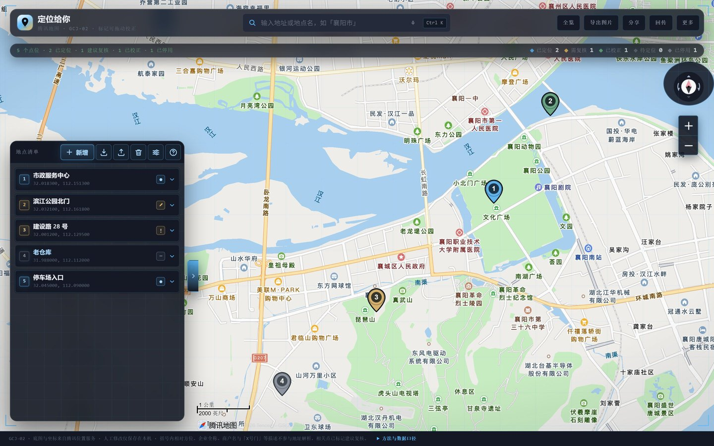
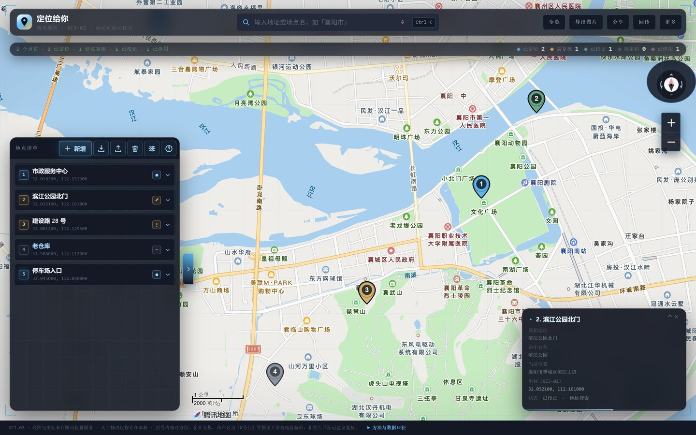
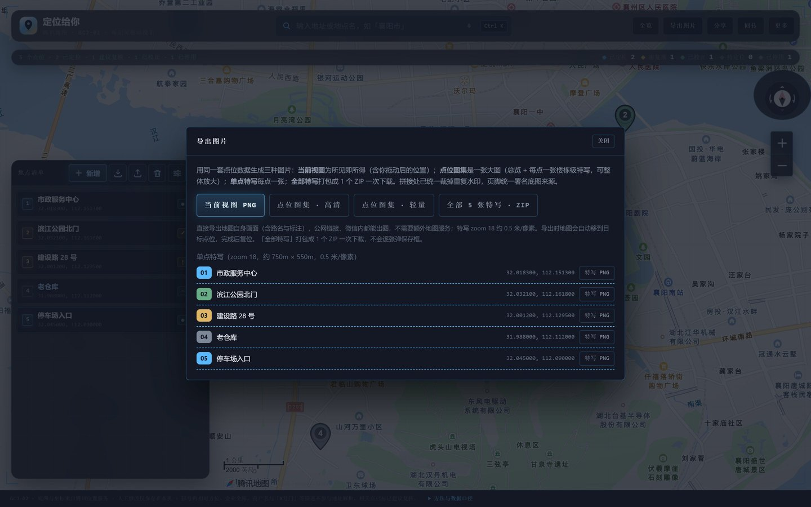
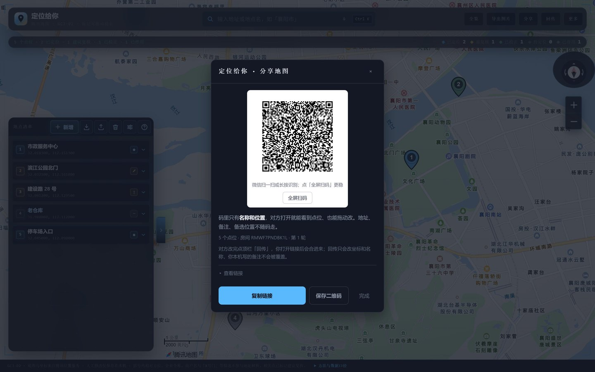
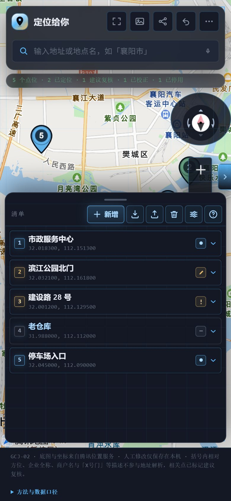
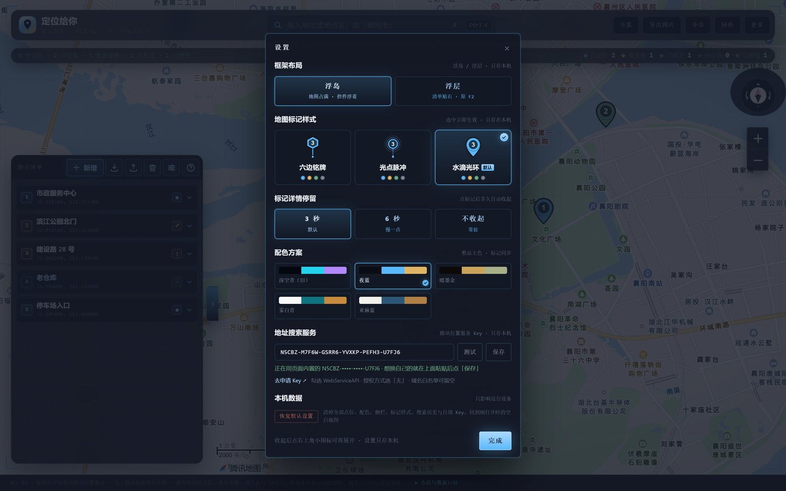

# 定位给你 · PinDrop Map

一张**空白起步**的地点标注地图：单个 HTML 文件、腾讯地图 GL 打底，点位全部由你自己搜索 / 新增 / 导入，
可拖动校正、可导出 PNG / CSV / JSON，也能把整份点位加密后装进链接或二维码发给别人，再把对方的改动合并回来。
**零服务器、零注册、零预置点位**。



- 打开就是空地图，不预置任何点位；你的点位、配色、历史只存在**自己这台浏览器**里
- 分享时点位用 AES-GCM 加密、压缩后放进链接的 `#` 部分（`#` 不随请求发给服务器），**仍然不经过任何服务器**
- 底图与地址搜索用腾讯位置服务，坐标统一 GCJ-02；腾讯地图 Key 可内置，也可换成自己的
- 单文件 `assets/map.html`，双击就能用，不需要装环境

---

## 一、程序功能

| 功能 | 说明 |
| --- | --- |
| 地址搜索 | 顶部搜索框调腾讯位置服务「关键词提示」。先按原样查，没结果再依次去方位词、企业后缀、行政区前缀、取主体名重试，最多 4 轮；仍无候选时走门牌精确解析（地理编码） |
| 模糊写法 | 「襄阳市」「建设路」「建设路 28 号」都能搜；命中后飞到 zoom 17（约 1.2 米/像素，能看清楼栋） |
| 语音输入 | 搜索框右侧话筒，点一下说地名，停顿后自动填入并搜索；再点或 `Esc` 取消 |
| 新增点位 | 「＋新增」可只填名称（先挂为「未匹配」），也可填地址取坐标，或直接填 GCJ-02 经纬度；编号自动取当前最大号 +1 |
| 拖动校正 | 地图上的钉子可以直接拖，松手坐标即更新，状态变「已校正」；也可「点选位置」「输入坐标」，随时「还原该点」 |
| 状态与停用 | 四态：已定位（青）/ 需复核（黄）/ 已校正（紫）/ 待定位（灰）。「停用」只置灰并移出统计，点仍在图上、仍参与导出；「删除」是彻底移除 |
| 导出数据 | 「更多」里导出 CSV 与坐标 JSON，含原始地址、标准地址、经纬度、坐标系、状态、来源与备注 |
| 导出图片 | 当前视图 PNG、点位图集（总览 + 每点一张特写）、单点特写（1500×1100）；「全部 N 张特写」一次打包成 **1 个 ZIP** |
| 分享 | 点位加密压进链接，另附二维码；码里只有名称和位置，37 个点位实测 v17（85×85），随手能扫 |
| 回传合并 | 对方改完点「回传」，把文本发回；你打开后按点位 id 合并，只有你没动过的点才采纳，两边都改以你的为准 |
| 外观 | 6 套配色、3 种标记样式（六边铭牌 / 光点脉冲 / 水滴光环）、详情停留 3 秒 / 6 秒 / 不收起 |
| 框架布局 | 「浮岛」（默认，地图铺满、控件浮着）与「浮层」（清单贴右，原 F2）两套，可随时切回 |
| 复位 | 设置 → 本机数据 →「恢复默认设置」（点两次）；或链接后面加 `?reset=1` |
| 快捷键 | `⌘/Ctrl + K` 聚焦搜索，`↑↓` 选候选，`Enter` 定位，`Esc` 关闭 |

---

## 二、使用方法

### 1. 打开

双击 `assets/map.html` 即可，或放到任意静态托管上。第一次打开是一张空白地图。

### 2. 加第一个点位

顶部搜索框输入地名 → 候选项里点一个 → 点「加入清单」，点位进入清单并落图。
想先看效果：**更多 → 载入示例**，会加 1 个示例点，可以随便拖、随便删。

### 3. 校正位置



- 直接拖钉子，松手即写回坐标，状态自动变「已校正」
- 或者选中该点 → 「点选位置」在地图上点一下 / 「输入坐标」填经纬度
- 右下角详情卡会显示标准地址、GCJ-02 坐标、状态与来源；默认 3 秒后收起成小图标，可在设置里改成 6 秒或不收起

### 4. 导出



- **当前视图 PNG**：所见即所得，含图例与署名
- **点位图集**：一张大图（总览 + 每点一张楼栋级特写），可整份保存
- **全部 N 张特写 · ZIP**：N 张 PNG 在内存里编码好，一次落盘，只弹一次保存框；失败项可「只重试这 N 张」

### 5. 分享给别人



点顶栏「分享」→ 生成加密链接 + 二维码。点位不多时直接出码，微信扫一扫或长按识别即可打开；
码偏密时点「全屏扫码」铺满屏幕再扫。**谁拿到链接谁就能读写**（密钥也在链接里），别转发给无关的人。

### 6. 把改动收回来

对方改完点顶栏「回传」，把那段文本发回给你；你打开后按点位 id 合并。
这是「发回一次、合并一次」，不是实时同步。分享与回传都只带**名称和坐标**，你自己写的备注、标准地址、
备选位置不会被对方覆盖。

### 7. 在手机上



- 点位清单是**贴底抽屉**，约占半屏，上半屏留给你看地图；点抽屉顶部那根短横条可铺满，再点收回
- 顶栏五个按钮是图标（全览 / 导出图片 / 分享 / 回传 / 更多），悬停或长按看说明
- 卡片里的状态只显示图标（圆点 / 笔 / 叹号 / 横线），点开卡片写着全称
- 名称会去掉括号里的门牌号与分店说明，太长自动截断；全名在悬停提示与详情里，导出的文件名不受影响
- 地图自带的缩放 `+ / −`、罗盘、左下比例尺会自动让开浮卡，不会被顶栏、状态条或清单压住

### 8. 设置与清空



设置里能改框架布局、标记样式、详情停留、配色、地址搜索 Key，最后是「本机数据」。
清除**不可撤销**，会清掉这台浏览器里全部点位与设置；要留档先导出 CSV / JSON / 图片。

---

## 三、把地图发给别人之前

- 链接很长是正常的：零服务器下，整份点位必须装进链接本身。1.4.4 去掉可推导的基准数据、
  1.4.5 压缩明文排布、1.4.6 换成 41 进制字母表、1.4.8 只发名称与坐标 —— 37 个点位因此从 v40 降到 v17。
- 被聊天软件截断时弹窗会提示重新复制整条；载入分享会覆盖本机原有清单，页面会先弹确认。
- 微信里下载常被拦：点右上角 ··· → 在浏览器中打开再导出；iOS 到「文件」App → 下载项里找。

---

## 四、版本升级内容

本次发布 **1.4.20**。最近几个版本都在解决「手机上能不能用」「界面是否干净」「提交能不能过」：

| 版本 | 一句话 | 关键改动 |
| --- | --- | --- |
| **1.4.20** | 单击地图即可标记位置 | 单击地图空白处弹「标记这个位置？」确认窗，先反查道路信息给你看，选是就打标记、放大、弹详情卡，一键加入清单；矢量/静态底图都支持，点已有标记和拖动不误触 |
| **1.4.19** | 详情卡避让浮岛 + OCR 吞点还原 | 详情卡按顶栏实测底边动态下移，不再被浮岛挡住；截图 OCR 吞掉经度小数点时按数值特征还原（1121578…→112.1578…），中文标签乱码/电量门牌噪点都不受影响 |
| **1.4.18** | 粘贴定位补齐标记与图片识别 | 确认跳转后打标记、放大到楼栋级并弹详情卡（对齐搜索体验）；图片识别覆盖微信/QQ 的 text/html base64 格式，识别中/失败都有明确提示 |
| **1.4.17** | 粘贴识别经纬度 | 经度框挪到前面；页面任意位置 Ctrl+V 识别坐标，文本离线可用、截图需联网 OCR；先弹窗问是否跳转，确认后定位，新增弹窗开着就顺手填表 |
| **1.4.16** | 经纬度填反也能解析 | 按中文「经纬度」习惯填成 112/32 不再报「地址太短了」；`coordPair()` 自动识别顺序并回写纠正，输入框标注改明确的纬度/经度 |
| **1.4.15** | 坐标反查填地址并定位 | 「新增地点」里填经纬度点解析，自动反查区域/街道/门牌/建筑名填入地址栏，名称没手填就取建筑名，地图飞到坐标放大到 17 级 |
| **1.4.14** | 打包结构修正 | 说明文档的配图从 `docs/img/` 拍平到 `docs/`（市场只收两级目录），打包器增加层级守卫，超两级当场报错；页面本体与 1.4.13 完全相同 |
| **1.4.13** | 地图原生控件不再被浮岛压住 | 缩放 `+ / −`、旋转罗盘整体下移到状态胶囊下方，左下比例尺与「腾讯地图」logo 右移让开清单卡；位置按实测计算，清单收放、切回浮层都会还原 |
| **1.4.12** | 换框架「浮岛」 | 顶栏变 56 高的悬浮胶囊、状态条变第二条胶囊、清单变左下 352×566 浮卡、详情挪到右下对角，地图四边全露；旧版「浮层」保留在设置里可切回 |
| **1.4.11** | 「更多」菜单点开收不回 | 补齐六条收起路径：点外面、焦点移走、切走窗口、移开鼠标（260ms 宽限）、`Esc`、滚轮缩放地图 |
| **1.4.10** | 手机上标记变成白色 | 钉子改为本地栅格化成 3 倍 PNG base64 再交给地图；导入新点位后同步重建样式表 |
| **1.4.9** | 手机侧栏占满屏 | 清单从全屏浮层改成 56% 贴底抽屉（可拉到 88%）、状态文字换成 18px 图标、点位名称去括号并在窄屏截断到 12 字、顶栏按钮缩成 34×34 图标 |

更早的 1.4.0–1.4.8（Taste 重排、ZIP 打包下载、层级修复、上架展示名、链接瘦身、二维码全屏扫描、
分享只带名称和坐标）见 [CHANGELOG.md](CHANGELOG.md)。

---

## 五、安装成技能（可选）

放到 WorkBuddy 的技能目录，重启后即可在技能列表里看到「定位给你」：

- Windows：`C:\Users\YOUR_NAME\.workbuddy\skills\dingwei-geini\`
- macOS：`~/.workbuddy/skills/dingwei-geini/`

只用地图、不装技能也完全可以：直接打开 `assets/map.html`。

## 六、改这个页面

`assets/map.html` 是唯一真源，改完跑：

```bash
node scripts/check-defaults.mjs    # 静态体检（出厂默认、0 点位、存储键、形状与开关），52 项
node scripts/share-selftest.mjs    # 分享 / 二维码 / ZIP 回归（97 项，无需浏览器）
node scripts/marker-selftest.mjs   # 标记取图与样式表时机（8 项）
node scripts/menu-selftest.mjs     # 「更多」菜单收起路径（16 项）
python scripts/quick_validate.py . # 技能结构校验
node scripts/pack.mjs              # 重新打包 dist/dingwei-geini.zip
```

细节与约定见 `SKILL.md`。

<!-- github-repo-notes -->
## 关于这个 GitHub 仓库

这里是「定位给你」技能包的公开版本库，用于版本记录与收集使用反馈。

- 在线体验：https://xiangyang-9points.app.workbuddy.host/?sharecode=NNNTEDLJEX
- 想直接用页面：双击 `assets/map.html` 即可，无需安装任何环境
- 想装成 WorkBuddy 技能：`dist/dingwei-geini.zip` 是技能市场提交包
- 每次改了什么、为什么改，见 `CHANGELOG.md` 与提交历史
- 使用问题、建议、bug 请开 Issue，作者会在这里跟进

注：仓库中的地图页面已移除内置的腾讯位置服务 Key（避免被批量抓取滥用），
首次打开按页面提示填入自己的 Key 即可；线上体验链接不受影响。
